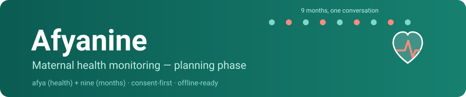

  

<h1 align="center">AfyaNine</h1>

  <b>afya</b> (health) + <b>nine</b> (months) · <i>maternal health monitoring — consent-first, offline-ready</i>

> **Status: prototype.** A first working stack ships demo data only — six bot-simulated
> mothers, no real maternal records, no auth layer yet. The consent gate described in
> [`docs/privacy.md`](docs/privacy.md) is a **pre-production mandate** and must exist
> before any real data is accepted.
>
> Where to read what: [`docs/HANDOFF.md`](docs/HANDOFF.md) (live task ledger + context
> snapshot + personas), [`docs/API.md`](docs/API.md) (endpoint contract ledger),
> [`docs/architecture.md`](docs/architecture.md) (target vs built), [`docs/privacy.md`](docs/privacy.md)
> (commitments + implementation status).

---

## Documentation

For the tested local setup and reusable Replit environment, see
[`docs/development.md`](docs/development.md).

| Document | What it covers |
|---|---|
| [`docs/HANDOFF.md`](docs/HANDOFF.md) | Agent/developer hand-off: task ledger, stack snapshot, sim personas, realism rules |
| [`docs/API.md`](docs/API.md) | Every live endpoint + realtime channel contract + Supabase DBA notes |
| [`docs/architecture.md`](docs/architecture.md) | Draft target component view + **reality check of what the prototype actually has** |
| [`docs/privacy.md`](docs/privacy.md) | Consent-first commitments + implementation status + compliance checklist |
| [`docs/contributing.md`](docs/contributing.md) | Commit rules, artifact hygiene ledger, review bar |

Visual assets: [`assets/banner.svg`](assets/banner.svg) · [`assets/logo.svg`](assets/logo.svg) · diagrams under [`docs/assets/`](docs/assets/).

## Purpose

Help expectant mothers and their supported caregivers track the pregnancy journey —
antenatal schedule reminders, vitals logging, symptom awareness, and connections to
healthcare providers.

The prototype implements the **demo core** of that idea: a Mother app (Wanjiku persona)
plus a CHW dashboard (Grace persona), live AfyaBand-style vitals over Supabase
Realtime, an SOS/emergency flow, and a simulation bot producing realistic
diurnal-curve readings for six test personas. See [`docs/HANDOFF.md`](docs/HANDOFF.md).

## Decision status

| # | Decision | Status |
|---|----------|--------|
| 1 | Target platform | ✅ Web-first (Next.js PWA-capable) in prototype; low-end Android still to verify |
| 2 | Core feature set (MVP) | 🔶 Subset live: vitals, tracking, SOS, CHW register, notes |
| 3 | Backend & data residency | ✅ Supabase Postgres (**eu-west-1** — residency open, see privacy doc) |
| 4 | Identity & access | ❌ Open — deliberately no auth yet |
| 5 | Offline strategy | ❌ Open — realtime-only today |
| 6 | Languages | ❌ Open — Swahili-first i18n not started |

## Non-negotiable design principles

1. **Maternal health data is sensitive by default.** Consent, minimization, and clear
   retention rules get designed in from day one — not retrofitted ([details](docs/privacy.md)).
2. **Works where the users are.** Patchy networks, older devices, low storage.
3. **No marketing data.** Health data never becomes ad or resale inventory.

## Next steps (pre-production gate)

- [ ] Implement the consent gate (per-category, per-viewer) on the write path
- [ ] Decide data residency (EU hosting vs in-region) + document the choice
- [ ] Real identity & access (phone-first for mothers, role-scoped CHW)
- [ ] Offline degradation strategy
- [ ] Threat-model the data flows
- [ ] Clean the artifact-hygiene debt listed in [`docs/contributing.md`](docs/contributing.md)
- [ ] Real-data lockdown review — **[gate] nothing goes live until this passes**

Then, and only then, real data.
