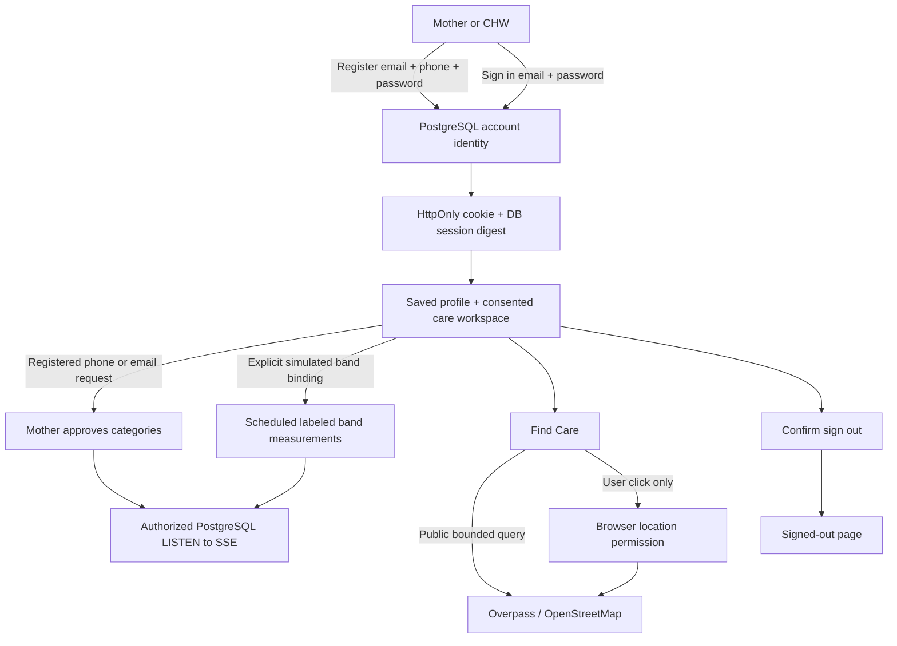

# Current implementation

See [live-accounts.md](live-accounts.md) for the database-backed email/password
accounts, phone-based linking, live SSE, SOS and bound-band simulator. It
supersedes the historical Supabase Auth workflow described below.

# Accounts, sessions and public care discovery

This is the PR #5 baseline decision. Its successor is
[care-team.md](care-team.md), with new private profile/consent/visit tables.
The user confirms Vercel already has Supabase public auth settings. The missing
configuration described below is specific to the isolated local sandbox, not a
claim that Vercel lacks it.

## Decision before implementation

Supabase Auth owns email/password credentials, confirmation, password recovery,
refresh tokens and account identity. Only display name is editable profile
metadata. Passwords are never stored by AfyaNine. SDK sessions persist in browser
storage, auto-refresh, and notify other tabs. Sign-out uses the current-device
scope and only reports success after Supabase confirms it. Email changes,
clinical roles and health-record linking are not user-editable profile fields.

The local sandbox has no Supabase URL/key; secret entry was declined. Auth must
remain visibly unavailable here rather than silently opening a demo account.
No fake auth provider or secret/service-role key is introduced.

Test Ward is a separate, explicitly fictional session, stored in sessionStorage
as persona code/role only. Reload restores that tab's selected persona. Demo
sign-out removes it. Demo APIs must only read/write `simulated=true` mothers;
real account signup grants no CHW access and does not map to Wanjiku's records.
Account Home/Vitals show an honest unlinked/empty state until health ownership,
consent, deletion and clinician access controls are implemented.

## Data and sync

No database schema change. Supabase user metadata holds the optional display
name; account email/creation/confirmation come from Auth. Health data remains
fictional only. Demo data refreshes on visible-tab intervals (30s) and focus;
a user-triggered fictional reading endpoint updates the selected demo persona,
without creating SOS events. No automatic bot runs or real device claim.

Find Care uses Leaflet and attributed OpenStreetMap tiles. Public Overpass
facility queries are bounded to 8km and 100 results, cached for five minutes.
The default centre is explicitly Nairobi, not the user's inferred location.
Use my location is opt-in and discloses third-party map queries; no coordinates
are written to a database or browser storage. Query coordinates are rounded to
three decimals and submitted in a POST body, not our access-log URL. Map/tile
providers receive the query area and IP and may keep their own request logs.
Map movement requires an explicit Search this area action.
Provider failure/empty results are shown honestly, never replaced by invented
nearby clinics. Opening hours, maternity services, and contact information are
only displayed when listed in the source; unknown is not "open". Distances are
straight-line estimates, not travel-time promises. Directions open an external
maps app only on a user click; no ambulance dispatch or clinical availability
is implied.

## Supabase setup and release gates

Set `NEXT_PUBLIC_SUPABASE_URL` and `NEXT_PUBLIC_SUPABASE_ANON_KEY` through secure
environment configuration, never chat or git. Enable Email/password auth,
configure production Site URL and authorized redirect URLs for
`/auth/callback` and `/auth/reset-password`, and configure SMTP/confirmation.
Do not disable email confirmation merely to make a test pass. Restart dev after
setting public Next.js variables. Production needs a new build with those vars.

Test sign-up/confirmation, sign-in, refresh/reload, recovery, profile save,
expiry and sign-out in a configured Supabase test project before release.
This identity layer is **not** a real-health-data release: consent enforcement,
ownership/CHW assignment, deletion and RLS audit remain separate blocking work.

## Checks

`node --experimental-strip-types --test tests/*.test.mjs` covers session parsing,
restoration/clearing, care normalization/distances and prior onboarding/reminders.
With the isolated local database and dev server running,
`node tests/demo-boundary.integration.mjs` inserts a clearly fictional
non-simulated access-control fixture, verifies it cannot be read or changed
through demo APIs, and deletes it in `finally`. It refuses non-local databases.

The public Overpass probes in this sandbox returned HTTP 406, timed out, or
reported HTTP 502 capacity exhaustion even with an identifying application agent.
Directory outages must remain explicit; no sample clinics are substituted.
Successful live facility retrieval and configured Supabase auth are outstanding
environment verification gates.
