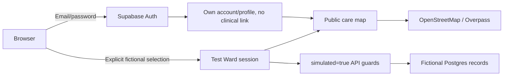

# Architecture — draft overview

> **Status: draft.** No stack or vendor is committed yet.
> The diagram below describes *responsibilities*, not technologies.

## What the component names actually mean

| Component | Responsibility | Why it is drawn this way |
|---|---|---|
| **Mother's phone** | Primary source of truth while offline. Vitals and symptoms are typed in or collected by peripherals (if added later), stored locally, cached. | Households have patchy data — the app must **never** lose usable function offline. |
| **Sync / outbound queue** | Resumable, retry-with-backoff upload path from phone → cloud, with conflict resolution that prefers **newer locally recorded values**. | Networks drop mid-upload; a queue decouples UX from connectivity. |
| **API + auth** | Phone-number-first identity (proposed), rate-limited, audited. | Low-friction login matters; phone numbers are universal in the target market. |
| **Consent service** | Holds current consent state per data category, per viewer. Every write is checked against it before it is allowed. | Consent is not a checkbox at signup — it is a **gate on the data plane**. |
| **Core data store** | Encrypted at rest, retention rules applied on schedule. | The single place maternal-health records live; smaller trust surface. |
| **Clinician view** | Case review and referrals, scoped so clinicians see only the consented subset. | Rewards consent: without it, a clinician sees less, not more. |
| **Aggregate analytics** | Population-level signals only, small-group shielding, no raw export, no third-party marketing data flow. | "No marketing data" principle outputs here. |

## Honest unknowns (tracked, not hidden)

- [ ] Exact sync conflict policy (last-write-wins per field vs. per-record)
- [ ] Where end-to-end encryption can meaningfully start (especially for CHW-mediated notes)
- [ ] Whether analytics runs in-region
- [ ] Realistic device floor (how old can the lowest supported Android be?)

## How this evolves

When a stack decision lands, this page gets a second diagram: the **technology view**
(ways components map onto concrete tools), and the component view is kept for the
"why it is shaped this way" record. Together they become the review artifact for
every future feature proposal.

---

## Reality check — current prototype (2026-11-07)

The stack decision **did land** (this section documents what actually got built —
verify against `package.json` / `prisma/schema.prisma` / [`docs/HANDOFF.md`](HANDOFF.md)):

| Target component | Prototype status |
|---|---|
| Mother's phone | ✅ Built as a web app (Next.js 16, React 19) — mobile-first browser experience |
| Sync / outbound queue | 🔶 Supabase Realtime `postgres_changes` replaces the queue idea for now; **no offline mode** |
| API + auth | ✅ API routes exist · ❌ **no authentication layer** (deliberately, for the demo) |
| Consent service | ❌ Not started — **the target architecture stands; it has not moved to center** |
| Core data store | ✅ Supabase Postgres (project "Imran", ref `xosqbyjzlhjnoscspvcc`, **eu-west-1**) with Prisma models: `Mother`, `VitalReading`, `VisitNote`, `Appointment`, `Emergency` |
| CHW / clinician view | ✅ CHW dashboard (Grace persona) with register + patient detail + notes |
| Aggregate analytics | ❌ Not built |

**Simulation reality:** six bot-owned mothers (`simulated = true`), diurnal-curves,
African Nairobi time-shifts, SOS only from the preeclampsia persona, and round-trip
reversion — see [`docs/HANDOFF.md`](HANDOFF.md) for the persona table and realism rules.

**What this means for the draft diagram above:** the *shapes* stayed true (mother side,
CHW side, realtime channel, one data store), but two big assumptions moved: the
"offline-first cache" is not yet real, and consent — drawn as the gatekeeper between
writes and storage — does not yet exist in code. Both are pre-production gates, not
nice-to-haves.

Open technical unknowns carried forward from the draft:

- [x] Stack chosen for prototype (Next.js + Prisma + Supabase)
- [ ] Sync conflict policy (currently realtime-direct; queue/retry semantics not built)
- [ ] End-to-end encryption scope (none today; CHW-mediated notes need an answer)
- [ ] Retention mechanics (none today)
- [ ] Lowest supported device floor (untested)

## Account and care expansion

See [accounts-care.md](accounts-care.md) for the implementation decision and
updated account/demo/public-map flow diagram. Supabase email/password identity
is separate from fictional Test Ward sessions; authenticated accounts do not
inherit a mother's records or a clinician role. Clinical data remains demo-only
behind `simulated=true` server filters. Profile metadata is owned and authorized
by Supabase Auth. Real-record consent, deletion and clinician assignment remain
unimplemented release gates. Local auth verification is blocked by missing
Supabase configuration, not replaced by a pretend sign-in.

