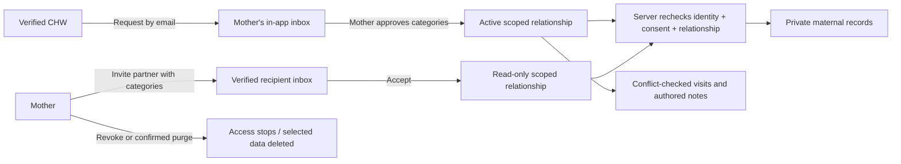

# Care-team relationships and operational records

This builds on PR #5. Existing Vercel Supabase settings are reused; local missing
settings are not evidence that production lacks them. No production database
migration or clinical-data activation is authorized by this document.

## Identity, permissions and contacts

Every account API validates the bearer token using Supabase `getUser`, requires a
confirmed email, and takes identity/admin claims only from the verified response.
Client role/subject IDs, user-editable metadata, and emails are not authorization.
The first profile selects Mother/CHW/Partner; changing role requires an operator.
CHW verification requires trusted `app_metadata.afyanine_admin=true`, never
`user_metadata`. Admin verification confers no access to maternal health records.
The confirmed policy is administrator-verified CHWs. Verification alone never
grants access: the mother must also approve each connection.

CHW requests go to a mother's verified email inbox without disclosing whether an
account exists. The mother sees the requester's name, institution and verified
status, chooses categories, then approves/declines. Until approval there is no
relationship or medical access. Partner invitations are initiated by the mother;
the recipient must accept while signed in with the invited verified email.
Invites expire after 14 days; duplicate pending requests are suppressed and
declined/revoked pairs have a cooldown. These are in-app prompts, not email sends.

Access is per relationship and category: vitals, pregnancy, visits, notes and
contacts. Partners are read-only. Only the accepted, verified CHW can schedule
visits/write notes for that mother, and only with the corresponding categories.
Mother revocation takes effect on subsequent server requests, not at JWT expiry.
Sharing and storage consent are separate. No invitation/contact entry grants
access on its own. A contact's supplied phone/email is not claimed verified.

## Data and deletion

New private tables are separate from legacy fictional Mother/VitalReading tables.
Own profile records hold contacts, institution details, verification date and
language. Stats derive from active accepted connections and actual recorded visit
statuses; no lives-saved or clinical outcome/impact claims are invented.

Storage consent is opt-in per category. Withdrawing a category or deleting the
care record requires explicit confirmation of deletion; visits deletion includes
their notes. Audit events contain IDs/actions/categories only, no health text,
phone numbers or email addresses. This is a prototype deletion policy, not an
assertion that clinical/legal retention obligations have been resolved.

Real clinical writes require `CARE_RECORDS_ENABLED=true` after operator review.
No production activation is performed here. Fictional workspaces can exercise
the same permission/visit service through a separate fixed-demo-actor API.
Every demo record/query is tenant-scoped; demo actors cannot access real accounts.

## Scheduling

Visits have start/end UTC instants, Nairobi/EAT display, place, status and an
authenticated author. Advisory transaction locks prevent overlapping schedules
for both CHW and mother. Mothers may cancel; completing and recording visit notes
requires the assigned CHW and current permissions. Notes are append-only and
mother-visible; partners see them only if the mother explicitly shares Notes.
No push/SMS delivery or automatic ambulance dispatch is implied.

## Language

EN/SW is shared across mother/CHW/partner navigation and settings, mirrored locally
for guests/demos and persisted in an authenticated account profile. Changing it
must not reset identity/session. Names, user-authored notes, institution names and
external provider data are not automatically translated. The separate
afyanine-ops repository is not modified by this change.

## Deployment and operator handoff

1. Review `prisma/care-team.sql`. It is additive and transaction-wrapped, with no
   legacy table changes. Run it once using the trusted server database role from
   `DATABASE_URL`, so that role owns the new tables. Do not run `db push` against
   production or add this migration to preview builds. If applying through a DBA
   account, deliberately establish the intended server-role ownership first.
2. Register/confirm the chosen verifier's Supabase account. Through a trusted
   Supabase administration workflow, grant that account protected
   `app_metadata.afyanine_admin=true`. Browser profile/user metadata must never
   grant it. The verifier can review identity/institution and approve CHWs;
   the mother still separately approves every relationship.
3. Validate real auth/account separation and the SQL ownership/permissions on a
   non-production Supabase project. Existing Vercel public auth settings are
   reused; no service-role key is introduced. `npm run build` generates the
   Prisma client but intentionally does not apply database migrations.
4. Keep `CARE_RECORDS_ENABLED` absent/false until clinical ownership, consent
   wording, statutory retention/deletion, minors/guardian and privacy review
   are approved. Only then explicitly activate real clinical storage. It is not
   enabled here. Public fictional workspaces always remain isolated.

Stats are database aggregates, not values inferred from the bounded UI lists.
Connection lists show at most100 rows, visit summaries100, record visits/readings50,
and visit notes250. This initial UI needs pagination before large-scale rollout.
Pending invitations expire after14days. Successful approval takes category
subsets; Notes requires Visits. Revoking a CHW cancels its scheduled visits;
revoking a partner does not cancel clinical appointments. Changing CHW identity
or institution revokes clinical grants and requires verification **and new maternal
approval**; reverification cannot revive old grants. Completed-visit counts describe
recorded work, not independently verified outcomes.

EN/SW settings are stored per authenticated profile and mirrored on-device; the
public fictional workspace uses the device setting across its different demo
personas. Names, authored notes, clinical source narratives and external provider
content retain their original language. Storage purge deletes selected medical
data/contacts/visits/notes, not the Supabase identity, basic account profile or
minimal authorization history. This is not a claim of statutory compliance.

## Verification

- `node --experimental-strip-types --test tests/*.test.mjs` —36 regressions,
  including shared/device-blocked language state and trusted admin claims.
- `npx tsx tests/care-workspace.integration.ts` — local-only synthetic identities:
  verification without maternal approval denies access; scoped CHW/partner reads,
  wrong-recipient denial, demo/account separation, read-only family grants even
  for verified CHWs, concurrent booking conflict, authored notes, future completion
  rejection, recorded completion, revocation, consent/purge and institution-change
  reapproval. Fixtures are removed in `finally`.
- `bash tests/care-migration.integration.sh` — temporary local database/role,
  additive SQL equivalence, RLS enabled on8tables and zero rows visible to a
  non-owner granted SELECT. No production connection accepted.
- Browser: maternal approval→CHW patients; manual fictional reading→partner
  read-only view→revoke/refresh; Nairobi scheduling/conflict and mother-visible
  note; profile EN→SW persisted in DB, reload and320px navigation.
- Live Supabase identity/sign-up/recovery/session-expiry and production DB
  migration remain separate verification gates, not passed by fictional actors.
