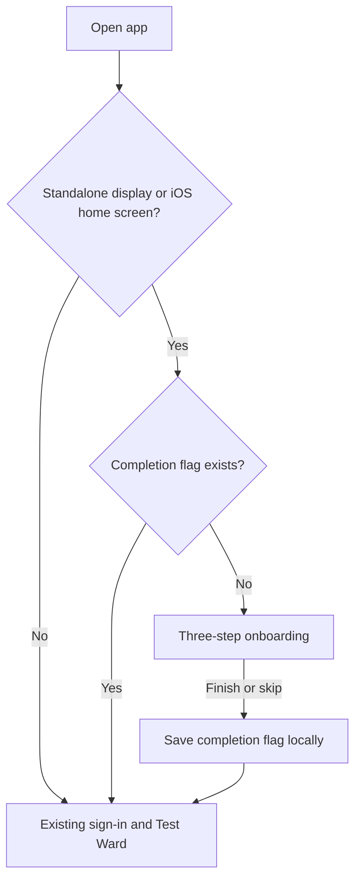
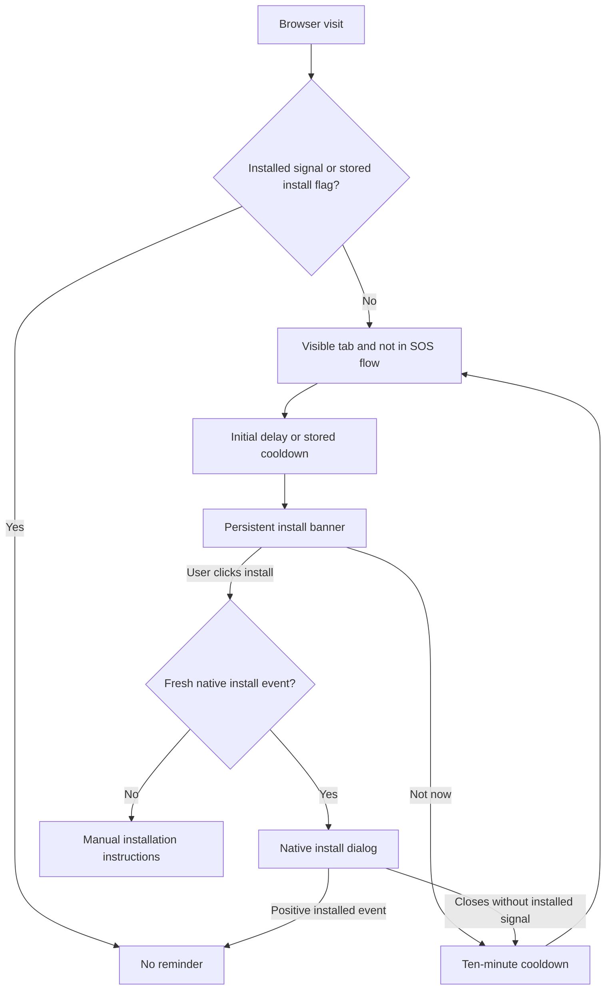

# Installed-app onboarding

The installed-app welcome flow is separate from the existing sign-in page.
The regular browser entry at `/` continues to show sign-in and Test Ward.

On a first launch in `display-mode: standalone` (or iOS
`navigator.standalone`), the app shows three introductory steps before sign-in.
Finishing or skipping stores only the versioned completion flag
`afyanine:onboarding:v1` in local storage; this is not authentication or consent.
Subsequent installed launches skip the introduction on the same device/browser
profile. Clearing site data resets the flag. If storage is unavailable,
completion is remembered only for the current page session.



Run the entry/persistence regression tests with:

```sh
node --experimental-strip-types --test tests/installed-onboarding.test.mjs
```

`/onboarding` is a review/replay route that works in a regular browser. Finishing
or skipping it goes to `/`. It does not simulate a native installation.

The web-app manifest requests standalone display and provides PNG launcher
icons, including a maskable icon and an Apple touch icon. Browser/OS-controlled
installation and launch splash screens vary by platform; the custom onboarding
appears after the app opens. No service worker or offline cache is introduced,
and the app still requires a network connection.

Use fictional accounts only. No actual SMS delivery, medical services,
authentication, consent enforcement, or offline support is added by this flow.

## Repeatable install reminder

The app-owned banner appears after five seconds in a visible browser tab and
stays until acted on. “Not now” snoozes it for ten minutes, including across
reloads/tabs when storage is available. It returns after that cooldown; there is
no permanent dismissal. Reminders pause while the tab is hidden or an SOS/trip
screen is open.

The banner captures `beforeinstallprompt` and opens the native install dialog
only from a user click, using each event at most once. Browsers decide whether
and when to provide a fresh event; repeating the in-app banner cannot override
their native prompt limits. Without an event, the action shows manual
installation instructions, including iOS Share → Add to Home Screen.

`appinstalled`, standalone display, or iOS home-screen mode stops reminders.
Only these positive signals store `afyanine:installed:v1`; dismissing or accepting
a native dialog does **not** mark installation complete. A local cooldown uses
`afyanine:install-reminder-next:v1`. No account or health data is stored.
There is no reliable cross-browser uninstall signal; clearing site data removes
the remembered install state, while an app installed elsewhere may not be
detectable from the current browser profile.



Run both entry and reminder regression suites with:

```sh
node --experimental-strip-types --test tests/installed-onboarding.test.mjs tests/install-reminder.test.mjs
```
