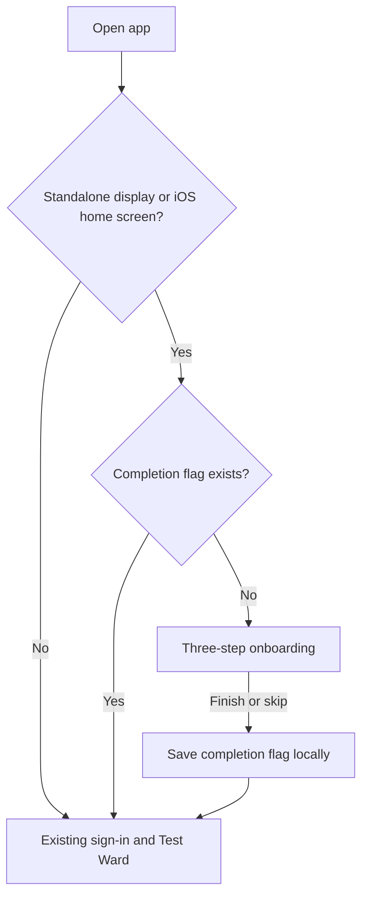

# Installed-app onboarding

The installed-app welcome flow is separate from the existing sign-in page.
The regular browser entry at `/` continues to show sign-in and Test Ward.

On a first launch in `display-mode: standalone` (or iOS
`navigator.standalone`), the app shows three introductory steps before sign-in.
Finishing or skipping stores only the versioned completion flag
`afyanine:onboarding:v1` in local storage; this is not authentication or consent.
Subsequent installed launches skip the introduction on the same device/browser
profile. Clearing site data resets the flag. If storage is unavailable,
completion is remembered only for the current page session.



Run the entry/persistence regression tests with:

```sh
node --experimental-strip-types --test tests/installed-onboarding.test.mjs
```

`/onboarding` is a review/replay route that works in a regular browser. Finishing
or skipping it goes to `/`. It does not simulate a native installation.

The web-app manifest requests standalone display and provides PNG launcher
icons, including a maskable icon and an Apple touch icon. Browser/OS-controlled
installation and launch splash screens vary by platform; the custom onboarding
appears after the app opens. No service worker or offline cache is introduced,
and the app still requires a network connection.

Use fictional accounts only. No actual SMS delivery, medical services,
authentication, consent enforcement, or offline support is added by this flow.
