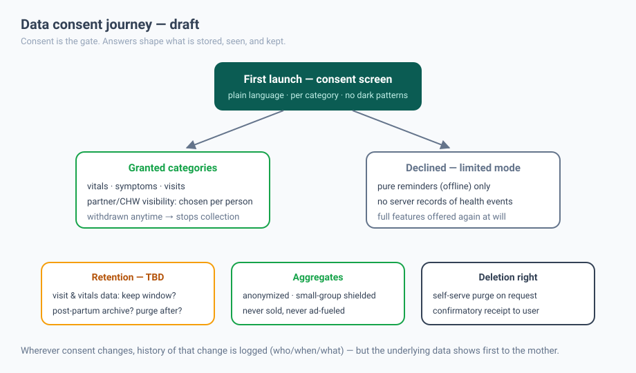

# Privacy — consent-first commitments

> **Status: draft** — these commitments are written down *before code exists* so that
> features can never quietly outgrow them. Amendments require editing this file visibly.

## The five commitments

1. **Consent before data.** No health category is stored or transmitted without an
   explicit, revocable grant from the mother. Consent is the gate on the data plane,
   not a UX formality.
2. **Contextual, not blanket.** The consent screen asks per category (vitals,
   symptoms, visits, partner/CHW visibility) in plain language, with the *option to
   decline* honored as a real state with real features (offline-only mode).
3. **Sensitive by default.** Maternal-health records are never sold, never blended into
   ad targeting or resale inventory, and never shipped with third-party trackers in
   the app.
4. **Minimize and bound.** Every collected field needs a purpose and a retention
   window. No purpose → no field. Retention windows are TBD but must exist per
   category; once chosen, they are enforced mechanically and published here.
5. **Deletion is self-serve.** A purge request doesn't require an email; the mother
   (or a guardian per policy) triggers it and gets a confirmatory receipt of what
   was destroyed and what was kept due to legal duty.

## Consent log

Consent state changes (grant/withdraw, per category, per viewer) are recorded so the
mother's record can answer "who knew what, when" — the log itself contains no health
data, only the change history.

## Regional compliance (to be validated)

Maternal-health data in the target region falls under personal-data protection laws
(e.g. **Kenya Data Protection Act, 2019** if Kenya-first). This section is a working
checklist — claims below get validated with proper advice before launch, not asserted
in confidence:

- [ ] Lawful basis mapping per data category
- [ ] Data-residency decision + hosting evidence
- [ ] Data-subject request path (access/correction/deletion) — self-serve vs. assisted
- [ ] Minors/guardianship policy for adolescent pregnancy scenarios
- [ ] Processor agreements with hosting, SMS, and analytics vendors

## Non-negotiables this doc backs into every future review

- Health data never becomes ad/resale inventory.
- Declining a category cannot degrade the app to "disabled" — limited mode stays useful.
- Any feature pull request that touches data flow must update a diagram (either this
  page or the architecture page) in the same pull request.

---

## Implementation status — prototype honesty panel (2026-11-07)

The prototype (see [`HANDOFF.md`](HANDOFF.md), [`API.md`](API.md)) ships demo data only,
and HANDOFF echoes that honestly. Per-commitment status:

| Commitment | Prototype status |
|---|---|
| 1. Consent before data | ❌ **Not implemented.** Supabase account identity is separate from health records; no clinical consent service exists. Demo-only APIs use `simulated=true` guards under the shared database role. |
| 2. Contextual, not blanket | ❌ Not implemented (nothing to gate yet) |
| 3. Sensitive by default / no marketing | ✅ Honored trivially — demo data only, no ad/analytics SDKs in the tree |
| 4. Minimize and bound | 🔶 Schema is small and purposeful, but no retention windows exist yet |
| 5. Deletion is self-serve | ❌ Not implemented |

**Operating rule while in prototype:** the demo must never hold real maternal data.
Real-data acceptance is blocked until commitments 1 and 5 exist in code — pre-production
mandate, not nice-to-have.

**Account expansion:** Supabase account identity/profile metadata and browser
session handling are implemented separately from clinical records; see
[accounts-care.md](accounts-care.md). This does not implement health-data consent
or deletion and does not lift the operating rule above. Real sign-in is disabled
where Supabase configuration is absent. Public care lookup uses third-party map
services; only an explicit location action requests browser permission, and an
approximate query centre is sent without durable location storage.

**Secrets hygiene (verified 2026-11-07):** `.env*` and `tokens.txt` are git-ignored;
Supabase management token and keys live outside the repo (per the secrets policy in
`HANDOFF.md`). Committed artifact debt is tracked in [`contributing.md`](contributing.md).
