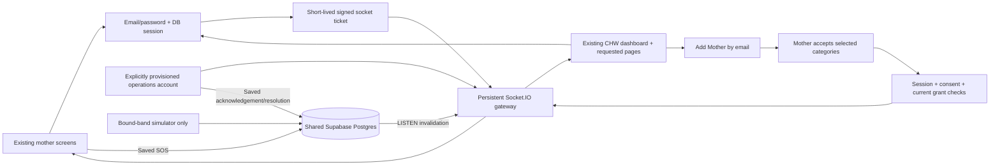

# Approved additions to the existing interface

Keep the main welcome art, typography, colours, spacing, cards and navigation.
Only add the explicitly requested account fields and CHW Patients/Visits/Profile
destinations. Add Mother takes an email. A request grants no access; the mother
chooses categories and explicitly accepts. Account pages must never substitute
the fictional ward's records on loading, empty data, or failure.

Registration: name/email/phone/password. Sign-in: email/password.
Database-backed password sessions and existing per-category authorization remain.
The separate Test ward stays visibly fictional and never shares account sessions.
Clinical data remains opt-in. Only bound-band measurements may be simulated.

Mother SOS is a committed database alert, not an animation. CHWs and the
operations account receive actual status updates. Acknowledge/resolve are saved;
dispatch/ETA/location must not be invented. Calls use the record's actual phone
in a tel: link, never a pretend "Calling..." toast. SOS explicitly discloses
sharing emergency details with authorized operations staff. Ordinary operations
health telemetry additionally requires the mother's separate operations consent.

Operations identities require an explicit CareOperator grant. A self-declared
email, CHW registration, or choosing an operations URL never grants staff access.
Provision an operator with a securely supplied password; do not promote an
existing unverified-email account unless that password authenticates it.

## Delivery

One persistent Socket.IO gateway shares PostgreSQL and the authorization service
with the web app. Signed short-lived socket tickets reference revocable DB
sessions. Every snapshot/action rechecks session, current grants and storage
consent. An operations ticket additionally requires a current operator grant.
Origin checks, reconnect, focus/manual refresh, offline states and backup polling
are explicit; no browser simulation is used as a failed live connection.

The gateway is not a Vercel serverless function. Production requires a persistent
host near the database and an explicit public gateway URL/origin allowlist.
Under200ms is a measured performance target, not a guarantee made by installing
Socket.IO. Record database-write-to-client timings, label local vs hosted tests,
and report the observed percentiles.

